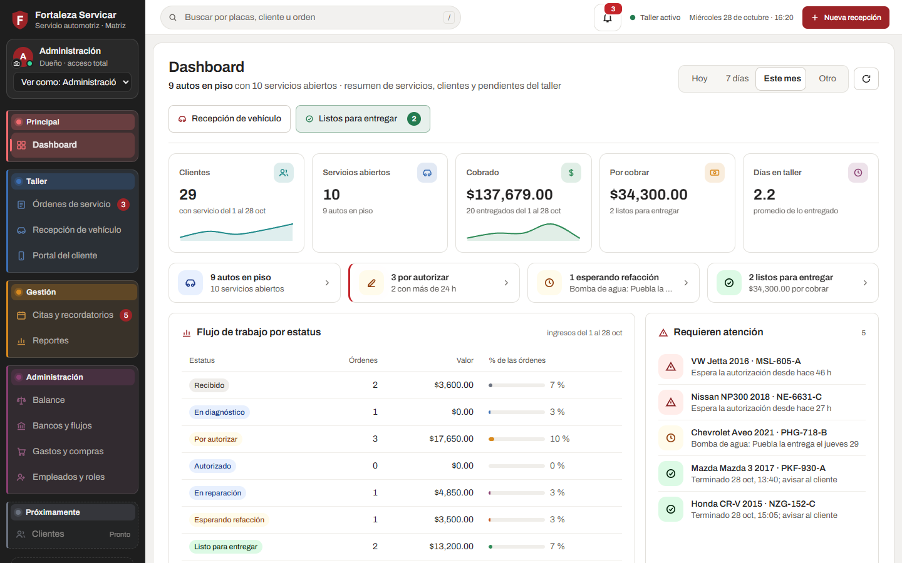
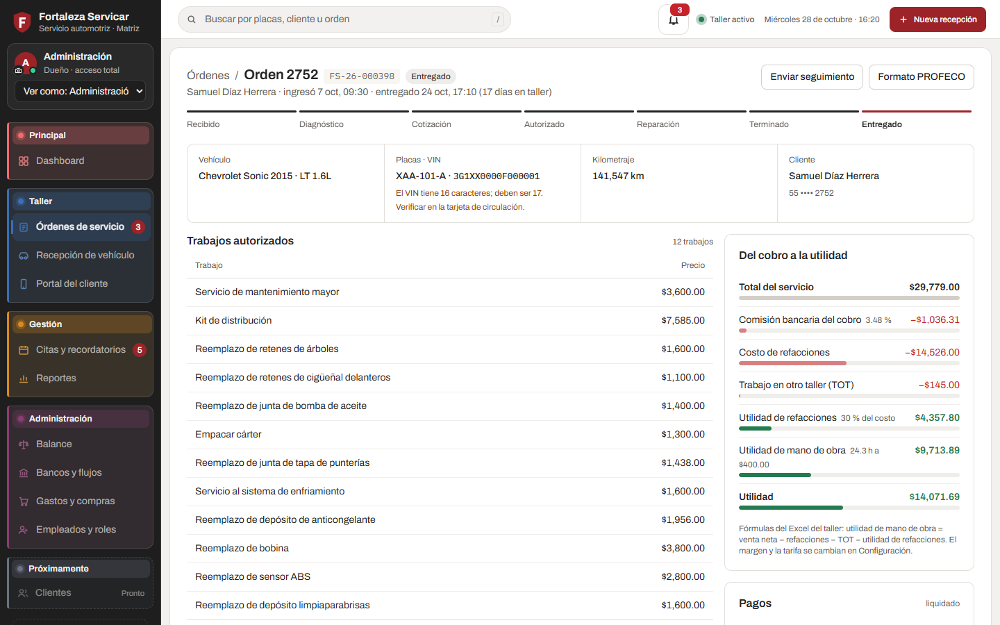
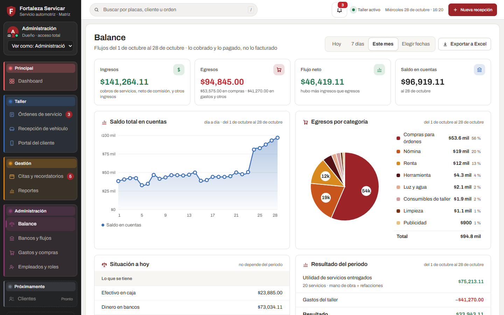
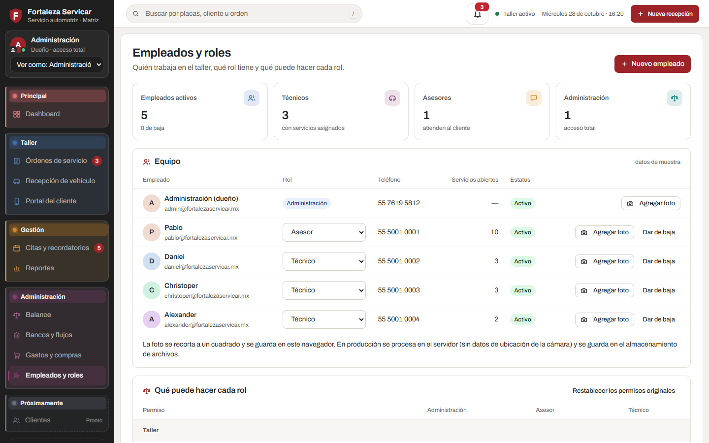
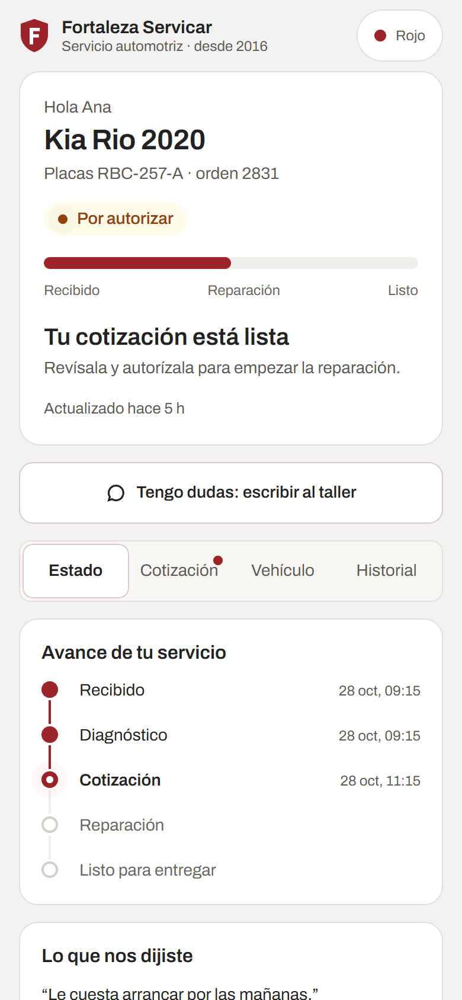

<div align="center">

# Fortaleza Servicar · ERP

**Sistema a la medida para un taller de servicio automotriz en México**

Órdenes y folios · recepción con firma · cotización · pagos y comisiones · portal del cliente · administración del dinero


</div>



## ¿Qué es?

Fortaleza Servicar opera hoy con una hoja de Excel donde cada orden ocupa un bloque de filas, y antes intentó sin éxito usar un software genérico de talleres. Este proyecto construye un ERP **a partir de lo que el taller ya mide**:

- utilidad de mano de obra y de refacciones;
- horas trabajadas;
- comisiones por pago con tarjeta;
- trabajos en otro taller (TOT);
- días en el taller.

Además, el sistema agrega lo que el Excel no puede: historial por cliente y por carro, permisos por rol y seguimiento en línea para el cliente.

> **Estado:** fase 0, análisis. Este repositorio contiene la especificación, el modelo de datos validado, los requisitos de seguridad y un **prototipo navegable sin backend** para validar el flujo con el cliente. El código de producción empieza en la fase 1.

## Lo que hace

| Área | Funciones |
|---|---|
| **Taller** | Órdenes con uno o varios carros (folios), estatus por carro, tablero, recepción con catálogo real de vehículos, diagrama de daños por carrocería, firma digital del técnico que recibe |
| **Dinero** | Cotización con servicios tabulados, pagos por efectivo, transferencia, MercadoPago o BBVA con su comisión e IVA, cascada del cobro a la utilidad |
| **Gestión** | Citas con la entrega ligada al carro, avisos de carros con más de 3 días en el taller, gastos y compras, reportes de rentabilidad |
| **Administración** | Balance y flujos por periodo, cuentas de caja y bancos, ingresos y egresos editables, empleados y **permisos por rol editables** |
| **Portal del cliente** | Enlace de seguimiento por orden: estatus de cada carro, cotización sin costos internos y autorización con código |

<table>
  <tr>
    <td width="50%"></td>
    <td width="50%"></td>
  </tr>
  <tr>
    <td align="center"><sub>Detalle de la orden: del cobro a la utilidad</sub></td>
    <td align="center"><sub>Balance por periodo</sub></td>
  </tr>
  <tr>
    <td width="50%"></td>
    <td width="50%" align="center"></td>
  </tr>
  <tr>
    <td align="center"><sub>Empleados y permisos por rol</sub></td>
    <td align="center"><sub>Portal del cliente en el celular</sub></td>
  </tr>
</table>

## Probar el prototipo

Solo hace falta Python 3 (o cualquier servidor de archivos estáticos):

```bash
git clone https://github.com/leonardoaguilar117/ERP-Fortaleza-Servicar.git
cd ERP-Fortaleza-Servicar/prototipo
python -m http.server 8765 --bind 127.0.0.1
```

| Abre | Para ver |
|---|---|
| http://127.0.0.1:8765/index.html | El ERP del personal |
| http://127.0.0.1:8765/portal.html#k7Qw2mZ9pL4xT8vR | El portal del cliente; el código para autorizar es `482913` |

### Con Docker (versión de prueba)

```bash
git clone https://github.com/leonardoaguilar117/ERP-Fortaleza-Servicar.git
cd ERP-Fortaleza-Servicar
docker compose up --build -d
```

Abre http://localhost:8080 para el ERP, o http://localhost:8080/portal.html#k7Qw2mZ9pL4xT8vR para el portal. Para detenerlo, `docker compose down`.

- La imagen (`docker/prototipo.Dockerfile`) sirve el prototipo con Caddy, sin privilegios de root, con cabeceras de seguridad y la ruta de salud `/healthz`.
- Escucha en `$PORT` (8080 por defecto), así que también se puede publicar como *Web Service* de Docker en Render o Railway.
- Sin Docker Compose: `docker build -f docker/prototipo.Dockerfile -t fortaleza-prototipo .` y luego `docker run --rm -p 8080:8080 fortaleza-prototipo`.

### En el navegador

- Usa **"Ver como"**, en la barra lateral, para cambiar entre Administración, Asesor y Técnico y ver cómo cambian los permisos.
- Prueba los temas Rojo, Oscuro y Claro, y la campana de notificaciones.
- Todo corre en el navegador. Los datos son ficticios; las 4 órdenes del Excel conservan sus montos para validar las fórmulas.

## Stack planeado

| Capa | Tecnología |
|---|---|
| Lenguaje | TypeScript de punta a punta; los cálculos financieros se escriben una sola vez y los comparten API, ERP y portal |
| API | NestJS 11 · Prisma · PostgreSQL 16 · pg-boss (colas y cron sobre PostgreSQL, sin Redis) |
| Front | React 19 · Vite · TanStack Router/Query · Tailwind 4 · shadcn/ui |
| Documentos | @react-pdf/renderer (sin Chromium) |
| Infraestructura | Una imagen Docker + dos sitios estáticos; Render o un VPS (decisión pendiente del cliente); respaldos diarios cifrados en Cloudflare R2 |

El razonamiento de cada decisión y los costos de hosting están en la [especificación, §4](docs/especificacion.md#4-arquitectura).

## Documentación

| Documento | Contenido |
|---|---|
| [`docs/especificacion.md`](docs/especificacion.md) | Alcance, **reglas de negocio** (única fuente), arquitectura, hosting, hoja de ruta y preguntas abiertas |
| [`docs/schema.prisma`](docs/schema.prisma) | Esquema de la base de datos (pasa `prisma validate`) |
| [`docs/modelo-de-datos.md`](docs/modelo-de-datos.md) | Cómo cada regla queda en las tablas y qué restricciones van en SQL |
| [`SEGURIDAD.md`](SEGURIDAD.md) | Requisitos de seguridad y privacidad (LFPDPPP), obligatorios desde la fase 1 |
| [`CLAUDE.md`](CLAUDE.md) | Reglas para desarrollar en el repositorio |
| [`PROGRESO.md`](PROGRESO.md) | Estado del trabajo y siguiente paso |

## Estructura

```
├── docs/                 especificación, esquema de datos, modelo de datos y capturas
├── prototipo/            prototipo navegable (HTML, CSS y JavaScript, sin backend)
│   ├── index.html        ERP del personal
│   ├── portal.html       portal del cliente
│   ├── css/              estilos y tokens de marca
│   └── js/               pantallas, datos de muestra, gráficas y diagrama de daños
├── docker/               imagen y configuración de Caddy para la versión de prueba del prototipo
├── docker-compose.yml    levanta el prototipo en http://localhost:8080
├── data/vehiculos/       catálogo de 416 modelos del mercado mexicano (255 con versión, motor y km/l)
├── color/ · img/         paleta oficial, layout de referencia y piezas de marca
├── SEGURIDAD.md · CLAUDE.md · PROGRESO.md
```

## Hoja de ruta

| Fase | Entregable |
|---|---|
| **0. Análisis** *(actual)* | Especificación, modelo de datos, seguridad, catálogo de vehículos y prototipo |
| **1. Fundaciones** | Monorepo, Docker, CI con escaneos de seguridad, autenticación y permisos, configuración |
| **2. Operación del taller** | Clientes y vehículos, órdenes y folios, recepción con firma, diagnóstico, cotización, pagos, portal, importación del Excel |
| **3. Gestión** | Citas y avisos, gastos y compras, reportes |
| **4. Administración** | Balance, bancos y flujos, empleados y permisos |

## Privacidad

Este repositorio **no contiene datos reales de clientes**:

- La hoja de operación del taller y las capturas del software anterior se quedan fuera (`.gitignore`), porque tienen nombres, teléfonos, placas y VIN.
- Los clientes del prototipo son ficticios.

---

<sub>Fortaleza Servicar · Servicio automotriz · desde 2016. Proyecto privado del taller: el código es visible, pero no tiene licencia de uso abierto.</sub>
