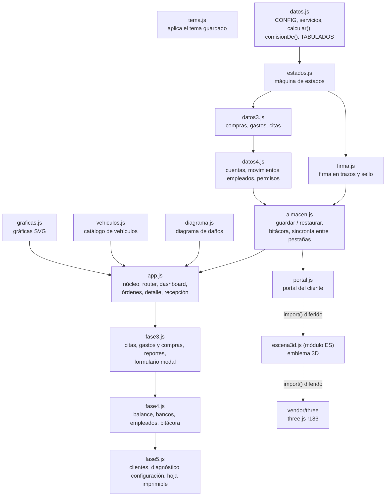
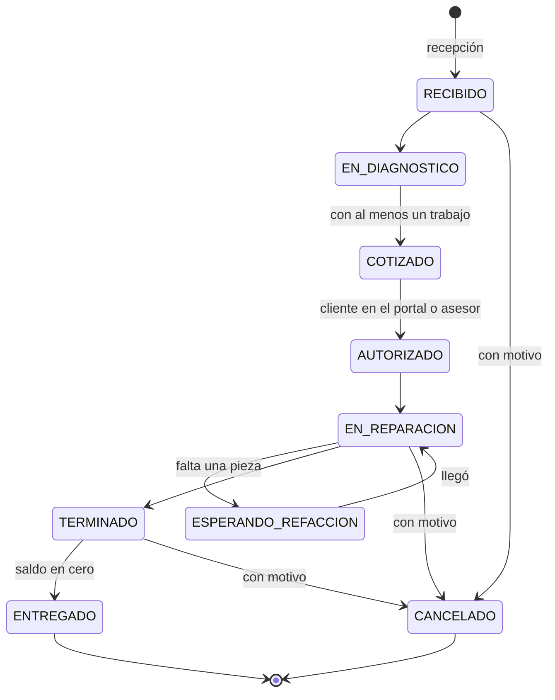
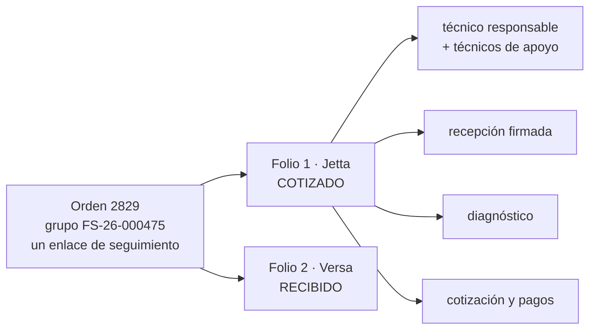
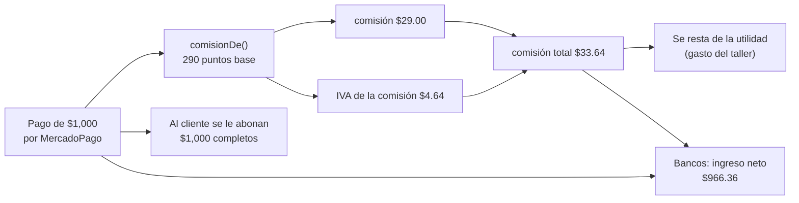
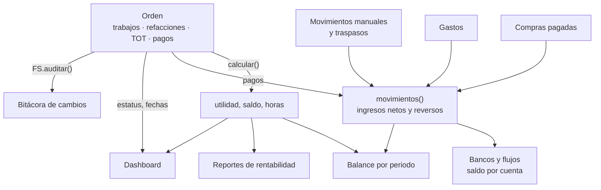
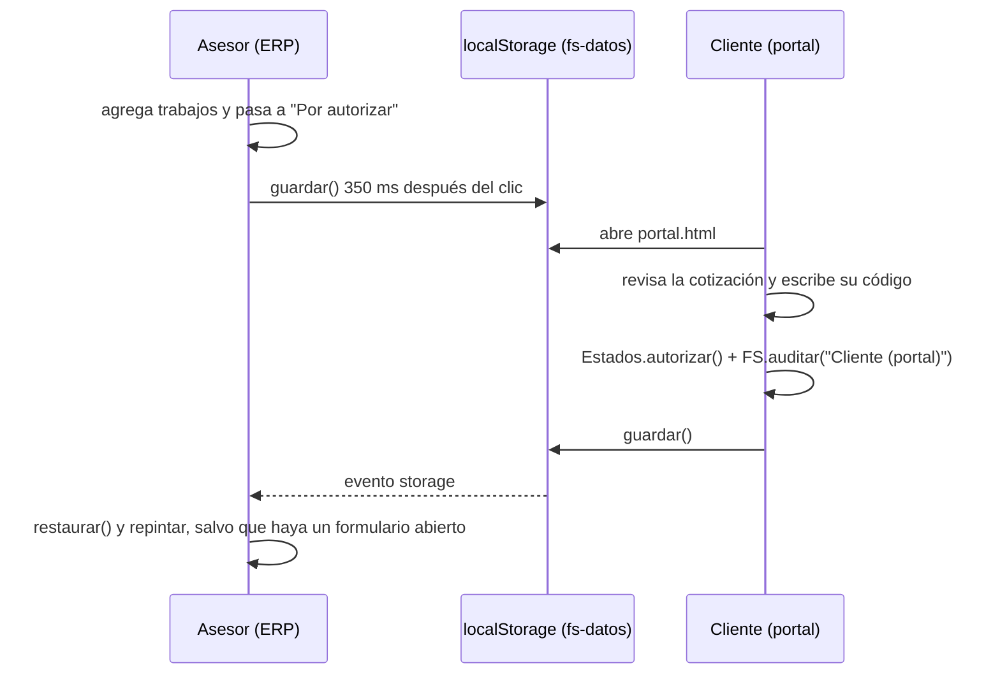
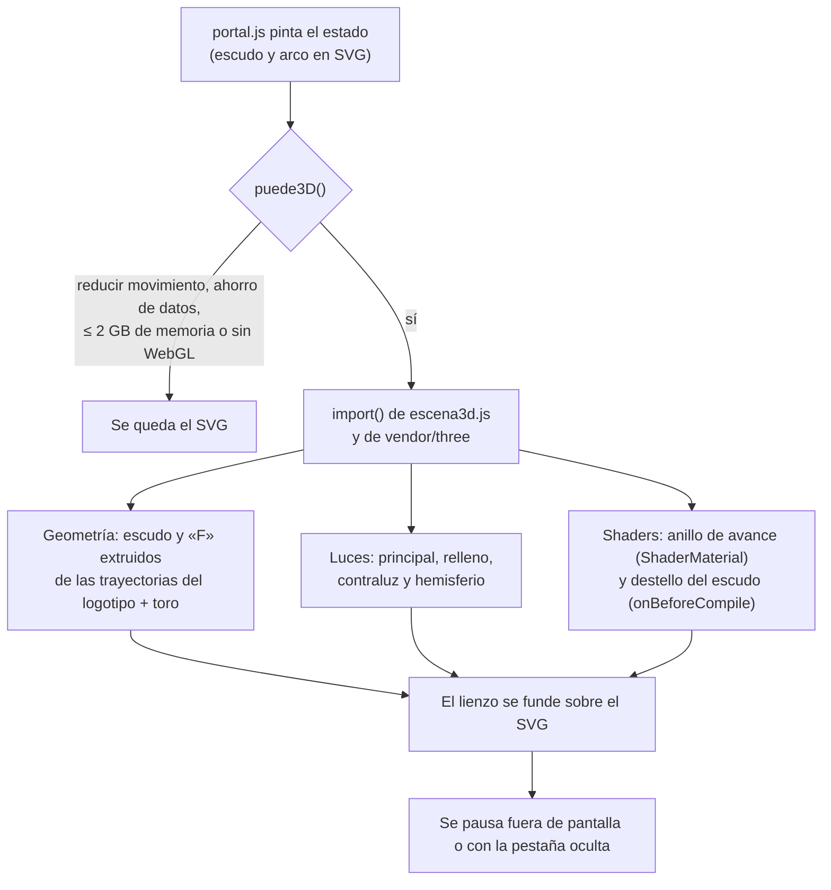

# Documentación técnica del prototipo

Describe **cómo está construido** el prototipo que vive en `prototipo/` y qué se le agregó el 2026-11-11 para que el flujo de una orden se pueda operar de punta a punta. Está escrita para quien va a leer o modificar el código.

- Las **reglas de negocio** no se repiten aquí: su única fuente es [`especificacion.md` §3](especificacion.md#3-reglas-de-negocio).
- La versión para el taller, sin tecnicismos, es [`guia-cliente.md`](guia-cliente.md).
- El prototipo **no es el sistema de producción**. No tiene servidor ni base de datos: todo corre en el navegador. La arquitectura de producción (NestJS, Prisma y PostgreSQL) está en [`especificacion.md` §4](especificacion.md#4-arquitectura) y sigue pendiente (fase 1).

## 1. Vista general

Son dos páginas estáticas que comparten datos y estilos. No hay paso de compilación: lo que está en `prototipo/` es lo que se publica.

```mermaid
flowchart LR
  subgraph Navegador
    ERP["index.html<br/>ERP del personal"]
    POR["portal.html<br/>Portal del cliente"]
    LS[("localStorage<br/>fs-datos · fs-permisos<br/>fs-tema · fs-rol · fs-foto-*")]
    ERP <--> LS
    POR <--> LS
  end
  subgraph Render
    CADDY["Caddy<br/>archivos estáticos + cabeceras"]
  end
  CADDY -- "HTML, CSS, JS" --> ERP
  CADDY -- "HTML, CSS, JS" --> POR
  GF["Google Fonts"] -. tipografía .-> ERP
  GF -. tipografía .-> POR
```



| Pieza | Dónde | Qué hace |
|---|---|---|
| ERP | `prototipo/index.html` | Dashboard, órdenes, recepción, citas, gastos y compras, reportes, balance, bancos, empleados y bitácora |
| Portal | `prototipo/portal.html#<token>` | Seguimiento del vehículo y autorización de la cotización con código de un solo uso |
| Servidor | `docker/Caddyfile`, `docker/prototipo.Dockerfile` | Sirve los archivos y pone las cabeceras de seguridad |
| Despliegue | `render.yaml` | Cada `push` a `main` vuelve a publicar en Render |

## 2. Módulos y orden de carga

Cada archivo es una función que se ejecuta al cargar y publica lo suyo en dos objetos globales: `window.FS` (datos y reglas) y `window.FSApp` (utilidades de pantalla). El orden de las etiquetas `<script>` es el orden de dependencias.



El portal carga solo `tema.js`, `datos.js`, `estados.js`, `firma.js`, `almacen.js` y `portal.js`: no recibe compras, gastos, cuentas ni empleados.

| Archivo | Responsabilidad | Publica |
|---|---|---|
| `js/datos.js` | Configuración del taller, servicios de muestra y cálculo de utilidad en centavos | `FS.CONFIG`, `FS.servicios`, `FS.calcular`, `FS.comisionDe`, `FS.TABULADOS` |
| `js/estados.js` | Catálogo de estatus y tabla de transiciones. **Único lugar donde cambia un estatus** | `FS.Estados` |
| `js/firma.js` | Firma del técnico: captura en lienzo, trazos como enteros con diferencias, SVG y sello SHA-256 | `FS.Firma` |
| `js/datos3.js` | Compras (derivadas de las refacciones y TOT de cada orden), gastos, citas y recordatorios | `FS.compras`, `FS.gastos`, `FS.citas`, `FS.recordatorios` |
| `js/datos4.js` | Cuentas, movimientos (derivados), empleados y matriz de permisos | `FS.movimientos()`, `FS.saldoDe()`, `FS.tiene()`, `FS.permisos` |
| `js/almacen.js` | Persistencia, validación de lo guardado, bitácora y aviso entre pestañas | `FS.guardar`, `FS.reiniciar`, `FS.auditar`, `FS.tokenNuevo`, `FS.alCambiarAlmacen` |
| `js/app.js` | Router por hash, permisos de ruta, pantallas del taller y captura dentro de la orden | `FSApp.registrarRuta`, `FSApp.render`, `FSApp.toast`, formatos |
| `js/fase3.js` | Citas, gastos y compras, reportes, formulario modal y exportación a CSV | `FSApp.formulario`, `FSApp.descargar`, `FSApp.nuevaCompra` |
| `js/fase4.js` | Balance, bancos y flujos, empleados y roles, bitácora de cambios | rutas `balance`, `bancos`, `empleados`, `bitacora` |
| `js/fase5.js` | Clientes, diagnóstico por sistemas, configuración del taller y hoja imprimible de la orden | rutas `clientes`, `diagnostico`, `configuracion`; `FSApp.imprimirOrden` |
| `js/portal.js` | Portal del cliente: estado de cada carro de la orden, cotización, vehículo, historial y autorización | — |
| `js/escena3d.js` | Emblema 3D del portal | `montarEmblema()`, `puede3D()` |

### Router y permisos

Las pantallas se registran una vez y el router valida el permiso antes de pintar:

```js
FSApp.registrarRuta('bitacora', renderBitacora, { permiso: 'bitacora', titulo: 'Bitácora de cambios' });
```

El hash tiene la forma `#/ruta/argumento?parametros`. Si el rol no tiene el permiso, se pinta la pantalla común "Sin permiso para tu rol". Los enlaces del menú con `data-need="permiso"` se ocultan igual.

> En el prototipo los permisos se revisan en el navegador y cualquiera puede cambiar de rol con el selector "Ver como". Eso sirve para **mostrar** el comportamiento, no para proteger datos. En producción el servidor valida cada endpoint contra `RolePermission` ([`SEGURIDAD.md`](../SEGURIDAD.md)).

## 3. La orden de punta a punta

### 3.1 Máquina de estados

`js/estados.js` define los estatus y sus transiciones. Ninguna pantalla asigna `servicio.estatus` por su cuenta: todas llaman a `Estados.cambiar()`, `avanzar()`, `autorizar()` o `entregar()`, que rechazan cualquier salto que la tabla no permita.



`CANCELADO` se alcanza desde cualquier estatus anterior a `ENTREGADO` (el diagrama muestra tres de esas flechas) y siempre con motivo: `Estados.cancelar()` guarda la fecha, el motivo y el estatus de origen. Un servicio cancelado ya no se edita, pero sus pagos se pueden revertir para devolver un anticipo.

### 3.1 bis Orden, folios y técnicos

Cada elemento de `FS.servicios` es un **folio** (un carro). Los folios de una misma orden comparten `grupo` (el código de la orden) y el enlace de seguimiento; el código del folio es el de la orden más el número del carro (`FS-26-000475-2`).



- La orden **no tiene estatus**: `Estados.resumenOrden(folios)` lo calcula ("1 de 2 carros por autorizar").
- **Agregar otro carro** abre la recepción con `?orden=<código>`: el cliente y el número de orden vienen de la orden.
- **Técnicos:** `tecnico` es el responsable y `apoyo` la lista de los demás. Los reportes por técnico siguen contando al responsable; cómo se reparten las horas entre varios es pregunta abierta (§6).
- **Pagos:** se registran en el folio. La especificación los define por orden, con reparto proporcional entre folios como *propuesta* (§6); hasta que el taller lo confirme, el prototipo no reparte.

### 3.1 ter Recepción firmada y diagnóstico

- **Firma** (`js/firma.js`, especificación §3.3): el lienzo guarda los puntos como enteros, el primero absoluto y los demás como diferencia (`"40,40,18,19,18,1…"`, unos 200 bytes). El sello es el SHA-256 de los trazos, el folio, el técnico y la hora. El detalle vuelve a calcularlo y muestra *firma íntegra* o *firma alterada*. Los trazos solo admiten números (`Firma.valida`), porque se insertan en el atributo `d` de un `<path>`.
- **Diagnóstico** (`#/diagnostico/<folio>`, M06): plantillas por sistema; cada punto queda como Bien, Atención o Urgente, con nota. Ningún punto empieza marcado y no se guarda hasta marcar todos los de los sistemas elegidos. Las plantillas son de muestra.
- **Hoja de la orden** (`FSApp.imprimirOrden`): arma la hoja y usa la impresión del navegador (`@media print` en `css/fase5.css`). No lleva costos, proveedores ni utilidad, y solo lleva precios si el rol ve importes. Los datos fiscales salen de **Configuración**; no trae las cláusulas del contrato PROFECO (pregunta abierta 10).

### 3.2 Qué se captura en cada etapa

Todo vive en el detalle de la orden (`renderDetalle` y la tabla de comandos `ACCIONES_DETALLE` en `js/app.js`). Cada acción exige su permiso, recalcula la utilidad y deja un registro en la bitácora.

| Acción | Cuándo está disponible | Permiso | Función |
|---|---|---|---|
| Agregar o quitar un trabajo | En diagnóstico y por autorizar | `cotizar` | `agregarTrabajo`, `quitarTrabajo` |
| Agregar refacción o TOT | Mientras la orden esté abierta | `gastos` | `FSApp.nuevaCompra(codigo)` |
| Registrar la autorización | Por autorizar | `autorizar` | `ACCIONES_DETALLE.autorizar` |
| Esperar refacción | En reparación | `estatus` | `esperarRefaccion` |
| Asignar o cambiar técnico | Mientras la orden esté abierta | `estatus` | `asignarTecnico` |
| Registrar un anticipo | Con saldo, antes de terminar | `pagos` | `registrarPago` |
| Revertir un pago | Mientras la orden esté abierta | `pagos` | `revertirPago` |
| Registrar pago y entregar | Terminado | `pagos` | `registrarPago` + `entregar` |

Detalles que conviene conocer:

- **Servicios tabulados.** Al elegir un trabajo de `FS.TABULADOS` se propone su precio de referencia. La partida guarda `[descripción, precio real, precio tabulado]` y la pantalla muestra el tabulado cuando difiere. Los precios del catálogo son **datos de muestra**.
- **Botón principal deshabilitado.** No se puede pasar a cotización sin trabajos; el botón lo dice debajo ("Para cotizar, agrega al menos un trabajo").
- **Formularios.** Todos usan `FSApp.formulario()` (`js/fase3.js`). Si `alGuardar` devuelve `false`, la ventana no se cierra; así se rechaza, por ejemplo, un pago mayor al saldo.

### 3.3 Pagos, comisión y reverso

Un pago es una fila `[fecha, método, monto, comisión total, concepto, detalle]`. La plataforma **solo registra** el pago; no cobra.



- Las tasas están en `CONFIG.metodos` en puntos base (290 = 2.9 %, 210 = 2.1 %) y el IVA en `CONFIG.iva`. `comisionDe()` opera en centavos enteros. `tarjeta` y `msi` quedan marcados como históricos: solo sirven para leer los pagos del Excel.
- **Un pago no se borra.** `revertirPago` marca el original como revertido y agrega un movimiento con monto y comisión negativos. En Bancos, ese reverso aparece como egreso de la misma cuenta.
- La fórmula de utilidad del prototipo es la del Excel (la comisión se resta antes de calcular las horas). La diferencia con la regla vigente está documentada en [`especificacion.md` §3.4](especificacion.md#34-dinero).

### 3.4 Cómo llega un cambio a los demás módulos

Bancos, Balance, Reportes y el dashboard **no guardan copias**: se calculan cada vez a partir de las órdenes, las compras y los gastos. Por eso un pago registrado en una orden aparece de inmediato en todas partes.



## 4. Persistencia y sincronía entre el ERP y el portal

Antes, todo se perdía al recargar y el portal no veía lo que pasaba en el ERP. `js/almacen.js` lo resuelve sin servidor:



- **Una sola llave con versión** (`fs-datos`, `VERSION`). Si cambian los datos de muestra o su forma, se sube la versión y lo guardado con la anterior se descarta.
- **Se restaura sobre los mismos arreglos.** Los módulos conservan sus referencias (`FS.servicios` es siempre el mismo arreglo); solo cambia su contenido.
- **Referencias.** Una compra apunta a su renglón dentro de la orden. Como JSON no guarda referencias, se guarda la posición del renglón y se vuelve a enlazar al restaurar.
- **La utilidad nunca se guarda**: se recalcula con `calcular()`.
- **Cuándo guarda.** Después de cualquier clic, cambio o envío de formulario (con 350 ms de espera) y al cerrar la página. Si el texto no cambió, no escribe.
- **Restablecer.** El botón "Restablecer datos" de la barra lateral borra `fs-datos` y recarga. El tema, el rol, los permisos y las fotos son otras llaves y se conservan.

Límite conocido: esto sincroniza **pestañas del mismo navegador**. El teléfono del cliente y la computadora del taller no se ven entre sí hasta que exista la API (fase 1).

## 5. Bitácora de cambios

`FS.auditar(quién, acción, antes, después, servicio)` agrega un registro al inicio de `FS.auditoria` (máximo 500). Lo llaman las acciones de la orden, la recepción, las ediciones de Administración y el portal.

- Pantalla: `#/bitacora` (permiso `bitacora`, solo Administración por defecto), con búsqueda por orden, persona o acción y exportación a CSV.
- En el detalle de cada orden hay un panel con sus últimos cinco cambios.
- La pantalla es de solo lectura: no hay forma de editar ni borrar un registro.

## 6. Seguridad

La revisión cubrió el prototipo publicado (lo que cualquiera puede abrir en Render). Los requisitos de producción siguen en [`SEGURIDAD.md`](../SEGURIDAD.md).

| Hallazgo | Riesgo | Qué se hizo |
|---|---|---|
| El HTML tenía un script en línea para el tema | Impedía una política de contenido estricta | Se movió a `js/tema.js`, que además solo acepta los tres temas válidos |
| El servidor no enviaba política de contenido | Un script inyectado se habría ejecutado | `Content-Security-Policy` con `script-src 'self'`, sin `unsafe-inline` ni `eval`; también HSTS, COOP y CORP (`docker/Caddyfile`) |
| El teléfono del cliente llegaba sin filtrar a un enlace `wa.me` dentro de HTML | Inyección de HTML con un teléfono manipulado | `waUrl` y `telMask` dejan solo dígitos |
| La exportación a CSV escribía texto capturado tal cual | Una celda que empieza con `=`, `+`, `-` o `@` se ejecuta como fórmula en Excel | `descargar()` antepone un apóstrofo a esas celdas |
| Lo guardado en `localStorage` se usaba sin revisar | Un dato manipulado podía romper pantallas o llegar a un atributo | `almacen.js` valida forma, identificadores, tokens y referencias; si algo no cuadra, descarta lo guardado y vuelve a la muestra |
| Los servicios nuevos compartían un enlace de seguimiento de ejemplo | Un cliente habría visto la orden de otro | `tokenNuevo()` genera 16 caracteres con `crypto.getRandomValues`, sin sesgo |
| Una transición de vista interrumpida dejaba promesas rechazadas | Ruido en consola que oculta errores reales | `transicion()` las atiende |

Sin cambios, por ser límites propios de un prototipo sin servidor (y así están rotulados en la interfaz):

- El código de autorización del portal es fijo (`482913`) y se valida en el navegador.
- Los permisos por rol se aplican en el navegador.
- `style-src` permite `unsafe-inline` porque el prototipo escribe atributos `style`. En producción, con React y Tailwind, se retira.
- Los datos son de muestra: clientes, teléfonos, placas y VIN son ficticios. **Nunca se suben datos reales** (ver `.gitignore`).

La política completa:

```
default-src 'none'; script-src 'self'; style-src 'self' 'unsafe-inline' https://fonts.googleapis.com;
font-src https://fonts.gstatic.com; img-src 'self' data: blob:; connect-src 'self'; manifest-src 'self';
base-uri 'none'; form-action 'self'; frame-ancestors 'none'; object-src 'none'
```

## 7. Interfaz y movimiento

Los tokens (color, radios, duraciones y curvas) están en `css/fortaleza.css` y cambian con `data-theme`. Los estilos de lo nuevo están en `css/operacion.css` y no escriben ningún color a mano.

| Decisión | Motivo |
|---|---|
| En el teléfono, la acción principal de la orden va primero y a todo lo ancho; las secundarias, en dos columnas de 44 px | Antes las acciones competían con el título por la misma fila y lo dejaban en una columna angosta |
| "Cambiar técnico" vive en el panel Personal | La acción queda junto a lo que cambia y el encabezado conserva una sola acción principal |
| Un renglón recién agregado (trabajo, pago, reverso) se ilumina 1.1 s | Indica qué cambió después del repintado; no se usa con "reducir movimiento" |
| Un pago revertido y su reverso siguen a la vista, atenuados y tachados | El historial no se borra |
| Los botones responden al toque con `scale(0.97)` y solo se anima `transform` y `opacity` | Respuesta inmediata sin recalcular el diseño |

### Emblema 3D del portal (`js/escena3d.js`)

El escudo de la marca gira despacio dentro de un anillo que marca el avance del servicio. Está solo en el portal: el cliente lo ve pocas veces y ahí un detalle cuidado suma; en el ERP, que se usa cientos de veces al día, estorbaría.



- **Geometría.** `ExtrudeGeometry` sobre las mismas trayectorias del logotipo SVG, con bisel; el anillo es un `TorusGeometry`.
- **Luces.** Tres direccionales (principal, relleno y contraluz) y una `HemisphereLight`. Sin mapas de sombra: no aportan a un objeto visto de frente y cuestan una pasada extra.
- **Shaders.** El anillo usa un `ShaderMaterial` propio: `uv.x` recorre la circunferencia y todo lo que queda por debajo de `uAvance` se pinta con el color de marca; la punta lleva un brillo que late. El escudo extiende `MeshStandardMaterial` con `onBeforeCompile` para que una franja de luz lo cruce cada 9 segundos.
- **Movimiento.** Cada valor se interpola hacia su destino con amortiguación exponencial, así un cambio a mitad de camino continúa desde donde va. Cuando el cliente autoriza, el anillo avanza y el escudo da una vuelta.
- **Carga.** three.js r186 está copiado en `prototipo/vendor/three/` (licencia MIT incluida) para no depender de un CDN ni abrir la política de contenido. Pesa unos 420 kB comprimido y se descarga después del primer pintado, solo si el equipo puede con él. El Galaxy A11 de prueba se queda con el SVG.
- **Limpieza.** `destruir()` detiene el ciclo, desconecta los observadores y libera geometrías, materiales y el renderizador. Si el navegador pierde el contexto de WebGL, se vuelve al SVG.
- **Tema.** Los colores se leen de `--accent` y `--rule` y se actualizan al cambiar `data-theme`.

No se cargan modelos, texturas ni entornos HDR: toda la geometría se genera en código, así que no hay archivos 3D que descargar ni que mantener.

## 8. Cómo se verificó

Se recorrió el flujo en un Chrome real controlado por script, con el ERP y el portal en dos pestañas del mismo navegador, primero sin cabeceras y después con la misma política de contenido del `Caddyfile`. Son tres recorridos y todos pasan: el flujo de la orden (34 comprobaciones), lo agregado después —carros, firma, apoyo, cancelación, clientes, configuración y hoja— (48) y el diagnóstico a 360 px (11).

| Bloque | Qué se comprobó |
|---|---|
| Cotización | Sin trabajos no se puede cotizar y la pantalla lo explica; un servicio tabulado propone su precio; un precio vacío no se guarda |
| Portal | Ve la cotización, no muestra costo, utilidad ni proveedor; rechaza un código incorrecto; al autorizar, el ERP cambia **sin recargar** |
| Dinero | $1,000 por MercadoPago dan $29.00 + $4.64; un pago mayor al saldo se rechaza; el reverso conserva el original; la compra entra al costo con 30 % de utilidad |
| Otros módulos | La liquidación en efectivo entra a Caja; el reverso sale como egreso del banco; la bitácora registra cada paso, incluido el del cliente |
| Permisos | El técnico no entra a la bitácora ni ve importes en la orden |
| Persistencia | Al recargar todo sigue igual y la compra sigue enlazada a su renglón; un guardado con forma inválida se ignora |
| Varios carros | La orden 2829 muestra sus dos carros y su avance; el carro nuevo hereda cliente, número de orden y enlace; el portal deja elegir vehículo |
| Firma | Sin firma no se guarda; pesa menos de 1 KB; el sello se verifica y una firma manipulada se detecta; un guardado con trazos no numéricos se descarta |
| Técnicos y cancelación | Se agrega y se quita un técnico de apoyo; no se cancela sin motivo ni un entregado; el cancelado sale de "En piso" |
| Clientes y configuración | Búsqueda, ficha con sus vehículos, recepción con sus datos; un RFC inválido no se guarda; el técnico no ve importes ni entra a Configuración |
| Diagnóstico | Ningún punto empieza marcado; el hallazgo llega a la orden, a la bitácora y a la hoja impresa |
| 360 px | Las 15 pantallas del ERP sin desborde horizontal y con todos los botones de al menos 44 px |
| Consola | Sin errores, sin aserciones fallidas y sin violaciones de la política de contenido |

Lo que **no** se pudo comprobar en esta máquina:

- La imagen de Docker y el `Caddyfile` no se ejecutaron (no hay Docker). La política se probó con un servidor local que envía la misma cabecera, pero la sintaxis del `Caddyfile` se valida hasta el despliegue en Render.
- El emblema 3D se probó con el renderizador por software de Chrome, no en un teléfono real.
- El script de prueba depende de una herramienta local y no está en el repositorio; queda pendiente llevarlo a una prueba automatizada (Playwright) en la fase 1.

## 9. Cómo correrlo

```bash
# Sin Docker
cd prototipo && python -m http.server 8765 --bind 127.0.0.1
# ERP:     http://127.0.0.1:8765/index.html
# Portal:  http://127.0.0.1:8765/portal.html#QaZN4gbzMO4TXqmL   (código 482913)

# Con Docker (igual que en Render)
docker compose up --build -d      # http://localhost:8080
```

Para probar la sincronía, abre el ERP y el portal en **dos pestañas del mismo navegador**.

## 10. Qué cambia en producción

| En el prototipo | En producción (fase 1 en adelante) |
|---|---|
| `localStorage` y evento `storage` | API REST + PostgreSQL; refresco periódico con TanStack Query |
| `FS.auditar()` en memoria | Módulo de auditoría, solo inserción |
| Permisos en el navegador | Guard por endpoint contra `RolePermission` |
| Código fijo del portal | OTP por SMS: 5 minutos, 5 intentos, guardado con hash |
| `calcular()` en `datos.js` | `packages/shared/src/finance/`, con pruebas sobre las 4 órdenes del Excel |
| `estados.js` | `domain/` del módulo de órdenes, misma tabla de transiciones |
| Reloj fijo de la demostración (28 de octubre de 2026) | Hora real en `America/Mexico_City` |
| Clientes derivados de los servicios, agrupados por teléfono | Entidades `Customer` y `Vehicle` |
| Pago registrado en el folio | Pago de la orden, repartido entre folios según lo que decida el taller |
| Hoja con la impresión del navegador | PDF con `@react-pdf/renderer` y las cláusulas PROFECO |
| Parámetros del negocio de solo lectura | `BranchSetting` editable, con vigencia y auditoría |
| Sin importación | Importación del Excel (requiere el mapeo de estatus, pregunta abierta 3) |
