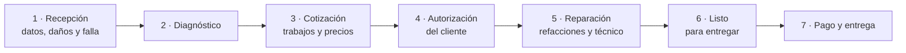
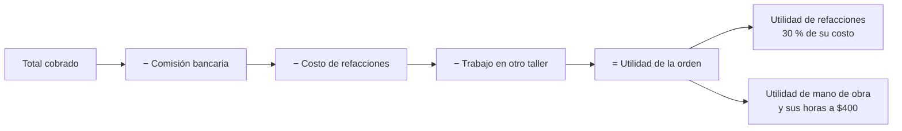

# Guía de Fortaleza Servicar: cómo funciona la plataforma

Esta guía explica, sin tecnicismos, qué hace hoy la versión de prueba y cómo se usa en el día a día del taller. Está pensada para Administración, el asesor y los técnicos.

> **Es una versión de prueba.** Los clientes, teléfonos y placas que aparecen son inventados. Lo que captures se guarda **solo en el navegador donde lo escribes**: sirve para probar el flujo y opinar, todavía no para llevar la operación real. Al final se explica qué falta para eso.

## 1. La idea en una imagen

Cada carro que entra al taller sigue siempre el mismo camino. La plataforma lo acompaña y, en cada paso, le dice a cada quien lo que le toca.

Lo que ganas frente al Excel:

- **Nada se captura dos veces.** El pago que registras en la orden aparece solo en Bancos, en el Balance y en los reportes.
- **La utilidad se calcula sola**, con las mismas fórmulas de tu hoja: 30 % sobre refacciones y $400 por hora de mano de obra.
- **El cliente ve su carro desde el celular** y autoriza la cotización sin llamar.
- **Queda registro de todo**: quién cambió qué y cuándo.

## 2. Quién ve qué

Hay tres tipos de usuario. Administración decide qué puede hacer cada uno en **Empleados y roles**, casilla por casilla.

| | Administración | Asesor | Técnico |
|---|:---:|:---:|:---:|
| Recibir vehículos y avanzar el estatus | Sí | Sí | Sí |
| Armar la cotización y ver precios | Sí | Sí | No |
| Registrar pagos y entregar | Sí | Sí | No |
| Ver costos, proveedores y utilidad | Sí | No | No |
| Gastos, compras, bancos y balance | Sí | No | No |
| Empleados, permisos y bitácora | Sí | No | No |

El técnico nunca ve dinero: ni precios, ni costos, ni pagos. El asesor ve lo que se le cobra al cliente, pero no cuánto gana el taller.

En la versión de prueba puedes cambiar de usuario con el selector **"Ver como"** de la barra lateral, para revisar qué ve cada quien.

## 3. Una orden, paso a paso

### Paso 1 · Recepción

Botón rojo **Nueva recepción**. Se captura al cliente, el vehículo (marca, modelo, año y versión salen de un catálogo de 416 modelos), el kilometraje, la gasolina y la falla que reporta.

El **diagrama de daños** muestra el carro por sus cinco lados. Eliges el tipo de daño (rayón, golpe, estrellado o faltante) y tocas la zona. La plataforma no deja guardar si no marcaste daños o no confirmaste "sin daños": así nadie reclama después un golpe que ya traía.

Al guardar, la orden queda como **Recibido** y se genera el enlace de seguimiento del cliente.

### Paso 2 · Diagnóstico

Con **Pasar a diagnóstico** la orden cambia de etapa. En el panel **Personal** asignas al técnico.

### Paso 3 · Cotización

En la orden, **Agregar trabajo**. Al escribir aparece la lista de servicios tabulados (afinación, balatas, alineación…) y se propone su precio; puedes ajustarlo. Si lo cambias, la orden recuerda cuál era el precio de lista.

Cuando haya al menos un trabajo se activa **Pasar a cotización**. Mientras no lo haya, el botón está apagado y debajo dice qué falta.

> Los precios del tabulador que trae la versión de prueba son de ejemplo. Hay que sustituirlos por los tuyos.

### Paso 4 · Autorización

Hay dos formas:

- **El cliente autoriza desde su celular.** Con **Enviar seguimiento** se le manda el enlace por WhatsApp. Ahí ve su cotización, toca **Autorizar** y escribe un código que le llega por mensaje. En cuanto lo hace, la orden cambia en la pantalla del taller.
- **El asesor registra la autorización** cuando el cliente la da por teléfono o en persona.

Desde ese momento ya se pueden comprar las refacciones.

### Paso 5 · Reparación

- **Agregar refacción o TOT**: anotas la pieza, el proveedor, el costo y la factura. El costo entra de inmediato al cálculo de utilidad de esa orden. TOT es el trabajo que se manda a otro taller.
- **Esperar refacción**: si falta una pieza, escribes qué se espera y para cuándo. La orden queda marcada, aparece en los avisos y el cliente lo ve en su enlace.
- **Registrar anticipo**: si el cliente deja dinero a cuenta.

### Paso 6 · Listo para entregar

Con **Pasar a terminado** el cliente ve "Tu vehículo está listo". Puedes **Agendar entrega** para que quede en la agenda de citas.

### Paso 7 · Pago y entrega

**Registrar pago y entregar** abre la ventana de cobro con el saldo. Eliges cómo pagó y la orden queda **Entregada**.

## 4. El dinero

### Cómo se registra un pago

La plataforma **no cobra**: solo anota lo que ya cobraste. Los métodos son:

| Método | Comisión | A dónde entra |
|---|---|---|
| Efectivo | Ninguna | Caja del taller |
| Transferencia | Ninguna | Banco |
| MercadoPago | 2.9 % más IVA | Banco |
| Terminal BBVA | 2.1 % más IVA | Banco |

La comisión es un gasto del taller: **al cliente se le abona completo lo que pagó** y la comisión se resta de tu utilidad, no del técnico.

Ejemplo: un pago de $1,000 con MercadoPago.

| | |
|---|---:|
| Se le abona al cliente | $1,000.00 |
| Comisión (2.9 %) | −$29.00 |
| IVA de la comisión (16 %) | −$4.64 |
| **Entra al banco** | **$966.36** |

### Si te equivocas en un pago

Un pago **no se borra**. Se usa **Revertir**, escribes el motivo y la plataforma registra un movimiento contrario. El pago original sigue a la vista, tachado, junto a su reverso. Así el historial siempre cuadra y nadie puede desaparecer un cobro.

### De lo cobrado a la utilidad

En cada orden, Administración ve el panel **Del cobro a la utilidad**:

Las cuatro órdenes de tu Excel de ejemplo (2752, 2824, 2825 y 2826) están cargadas y dan exactamente las mismas cifras que tu hoja.

### Bancos, gastos y balance

- **Bancos y flujos**: el saldo de la caja y del banco, con cada entrada y salida. Los cobros llegan solos desde las órdenes. Aquí también anotas depósitos, retiros y traspasos entre cuentas.
- **Gastos y compras**: la renta, la luz, la nómina y las compras a proveedores, con lo que está por comprar, pendiente de pago o pagado.
- **Balance**: cuánto entró, cuánto salió y cuál fue el resultado del periodo que elijas (hoy, 7 días, el mes o las fechas que quieras).
- **Reportes**: rentabilidad por orden, por técnico y por tipo de trabajo, con exportación a Excel.

## 5. Lo que ve tu cliente

El cliente recibe un enlace por WhatsApp. No instala nada ni crea una cuenta.

| Pestaña | Qué ve |
|---|---|
| **Estado** | En qué etapa va su carro y la fecha de cada paso |
| **Cotización** | Los trabajos y el total, el botón para autorizar, sus pagos y su saldo |
| **Vehículo** | Sus datos y los daños que se anotaron al recibirlo |
| **Historial** | Sus servicios anteriores |

Lo que **nunca** ve: lo que te costaron las refacciones, tu utilidad, tus proveedores ni datos de otros clientes.

En la parte de arriba aparece el escudo de Fortaleza Servicar dentro de un anillo que se va llenando conforme avanza el servicio. En celulares modestos se muestra como imagen fija, para no gastar datos ni batería.

## 6. Bitácora: quién hizo qué

En **Administración → Bitácora de cambios** queda cada movimiento importante: recepciones, cambios de estatus, trabajos agregados o quitados, pagos, reversos, compras, ediciones de gastos y también la autorización del cliente desde el portal.

Cada renglón dice **cuándo, quién, qué cambió, qué había antes y qué quedó**. Puedes buscar por número de orden o por persona y exportarla a Excel. No se puede editar ni borrar.

Dentro de cada orden hay un resumen con sus últimos cambios.

## 7. Avisos, citas y búsqueda

- **Campana de avisos**: cotizaciones sin respuesta desde hace más de un día, refacciones en espera y vehículos listos que nadie ha recogido.
- **Citas y recordatorios**: la agenda del taller. Una cita de entrega se marca sola como atendida cuando entregas el vehículo.
- **Búsqueda**: arriba, por placas, cliente o número de orden. También con la tecla `/`.
- **Tres estilos de color**: Rojo, Oscuro y Claro, al pie de la barra lateral.

## 8. Cómo probarla

1. Abre la plataforma y entra a **Órdenes de servicio**.
2. Elige una orden **En diagnóstico**, agrégale un trabajo y pásala a cotización.
3. Toca **Enviar seguimiento → Ver como cliente**. Se abre el portal en otra pestaña.
4. En el portal, entra a **Cotización**, toca **Autorizar** y escribe el código de prueba **482913**.
5. Regresa a la pestaña del taller: la orden ya dice **Autorizado**, sin recargar.
6. Avanza la orden, registra un anticipo con MercadoPago y revisa la comisión.
7. Termina, cobra y entrega. Luego mira **Bancos y flujos** y la **Bitácora**.

Si quieres empezar de cero, usa **Restablecer datos** al pie de la barra lateral.

## 9. Lo que todavía no hace

Para que no haya sorpresas, esto es lo que la versión de prueba **no** hace todavía:

| Hoy | Cuando esté el sistema completo |
|---|---|
| Lo capturado vive en un solo navegador | Todo se guarda en un servidor y se ve desde cualquier equipo |
| El cliente solo ve cambios si abre el portal en el mismo equipo de la prueba | El cliente lo ve desde su propio celular |
| El código para autorizar es fijo (482913) | Llega por mensaje, dura 5 minutos y admite 5 intentos |
| Cualquiera puede cambiar de usuario con "Ver como" | Cada persona entra con su correo y contraseña |
| El contrato PROFECO no se genera | Se genera en PDF con los datos del taller |
| La fecha está detenida en el 28 de octubre de 2026 | Usa la fecha y la hora reales |
| Un carro por orden | Una orden puede traer varios carros, cada uno con su estatus |

Fuera del alcance acordado, y por lo tanto no se construirán: inventario, venta de productos, facturación, cobro con terminal desde la plataforma, paquetes de precios y fotos de vehículos.

## 10. Lo que necesitamos de ti

Hay decisiones que solo el taller puede tomar y que cambian cómo se construye lo que sigue:

1. **El número de orden**: ¿continúa la numeración actual o empieza una nueva?
2. **Las horas tabuladoras**: ¿se usan para medir al técnico o solo como referencia?
3. **Varios carros en una orden**: ¿cómo se reparte un pago entre ellos?
4. **El tabulador de servicios** con tus precios reales.
5. **Las categorías de gasto** que usas.
6. **Dónde se va a alojar** el sistema, porque de eso depende el costo mensual.
